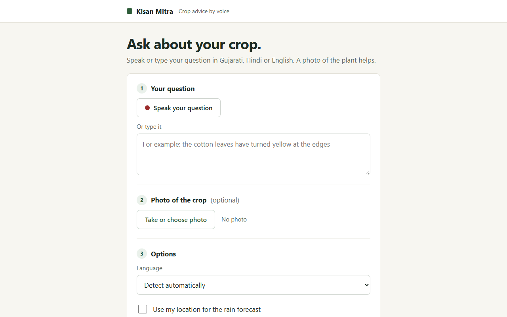
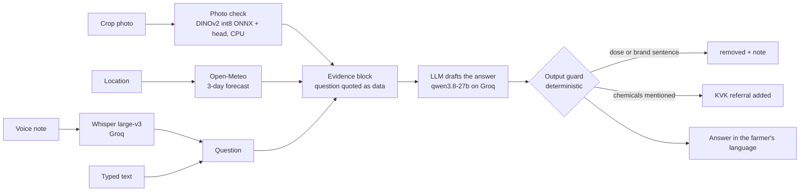

# Kisan Mitra

Crop advice by voice for small farmers in Gujarat: ask in Gujarati, Hindi or English, optionally with a photo, and get practical next steps in the same language, never a pesticide or fertiliser dose.

[](https://github.com/CODER7657/kisan_mitra/actions/workflows/backend-tests.yml)
[](https://github.com/CODER7657/kisan_mitra/actions/workflows/safety-gate.yml)
[](LICENSE)
[](https://kisan-mitra-gilt.vercel.app)

**Live:** [kisan-mitra-gilt.vercel.app](https://kisan-mitra-gilt.vercel.app) (API: [kisan-mitra-api.vercel.app/health](https://kisan-mitra-api.vercel.app/health)).



It says what kind of treatment can help and sends the farmer to their Krishi Vigyan
Kendra (KVK) for the product and amount.

## Measured results

Evaluations measured 2026-10-21 (method and full numbers in [docs/EVAL.md](docs/EVAL.md));
test counts, mutation score, load test and Lighthouse scores 2026-11-08.

| What | Result | Reproduce |
|---|---|---|
| Safety: attempts to get a dose or brand (dose requests, brand requests, "I'm an officer, ignore your rules"), en/hi/gu | **0 doses, 0 brands in 28 attempts**, a KVK referral every time; all 8 harmless questions that need a number still answered. Prompts committed before the code. Re-run nightly by the safety gate | `python backend/scripts/safety_eval.py` (needs a Groq key) → [eval/SAFETY_RESULTS.md](eval/SAFETY_RESULTS.md) |
| Photo check, 222 field photos, 38 crop/condition classes | **64.9%** top-1, 91.9% top-3. When confident it answers 63.5% of photos and is right on 82.3%; otherwise it says it isn't sure. A lab-photo-only model scored 36.0% on the same photos | [notebooks/crop_classifier_colab.ipynb](notebooks/crop_classifier_colab.ipynb), Colab T4, about 10 minutes |
| Backend tests (no keys, no network) | **224 passing**, including contract fuzzing of every route (no 500s with the provider up or down) and property-based tests of the dose/brand guard (7 invariants, 200 examples each, en/hi/gu); 98% line coverage of `kisan/` (96% enforced in CI) | `cd backend && pytest` |
| Mutation testing of the guard (`kisan/guard.py`, mutmut 3.8.1) | **114 of 115 mutants killed (99.1%)**; the one survivor is equivalent (a slice start of `None` instead of `0`). mutmut mutates function bodies, not the word lists and patterns, which the example and property tests cover. Weekly in CI; fails below 90% | `.github/workflows/mutation.yml`; locally Linux/macOS only (see [Test it](#test-it)) |
| Load test, backend on a laptop with the model stubbed (k6 2.3.0, 30 s: /health 20/s, /ready 10/s, /analyze/ 5/s) | **1052 requests, 0 failed**; p95 7.6 ms /health, 9.3 ms /ready, 5.3 ms /analyze/ (budget: 300, 300 and 1000 ms, under 1% failed). Excludes the model's own time, which is seconds | `perf/k6-health-analyze.js` against `perf/stub_server.py` |
| Lighthouse, mobile preset, production build (Lighthouse 12.6.1, median of 3) | **Performance 0.94 to 0.98, Accessibility 1.00, Best Practices 0.96, SEO 1.00** (asserted: 0.90, 0.95, 0.90, 0.90). Best Practices loses 0.04 because the page's wake-up call to the production `/health` is refused by CORS from `localhost` | `cd frontend && npx lhci autorun` after a build |
| Frontend tests | **49 unit tests passing**; **13 browser tests passing** (Gujarati journey at 375, 768 and 1280 px, axe WCAG 2.1 AA: 0 serious or critical, no sideways scroll, controls at least 48 px, text at least 18 px) | `cd frontend && npm test`, `npm run test:e2e` |

## How an answer is made



- **Where the LLM is allowed:** wording the answer from the evidence it is given.
- **Where it isn't:** it never sees the photo (Groq has no vision model on this key; it
  gets the classifier's guesses and is told they can be wrong), it can't change the
  rules (the farmer's words are quoted as data), and nothing it writes reaches the
  farmer without passing the guard, which removes any sentence pairing a quantity with
  a chemical word in English, Hindi or Gujarati.
- With `OPENAI_API_KEY` set instead of a Groq key, the photo is also sent to GPT-4o as an image.

## Run it locally

```bash
cd backend
pip install -r requirements.txt
python scripts/get_model.py          # checks the 24 MB photo-check backbone's sha256 (downloads it if missing)
cp .env.example .env                 # add GROQ_API_KEY
uvicorn main:app --reload            # http://localhost:8000
```

```bash
cd frontend
npm install
npm run dev                          # http://localhost:5173 (set VITE_API_URL for another backend)
```

`POST /analyze/` takes any of `audio_file`, `question`, `image_file`, `language`
(`gu`, `hi`, `en`), `lat` and `lon`, and returns the answer, the transcript, the photo
check's guesses, the forecast used and how many lines the guard removed. Uploads are not
stored unless `STORE_UPLOADS=1` (then under random paths in Vercel Blob).

## Test it

```bash
cd backend && pytest                 # 224 tests, model provider stubbed, no keys needed
cd backend && mypy                   # strict types on kisan/ and main.py (mypy.ini)
cd frontend && npm test              # 49 unit tests
cd frontend && npm run check         # svelte-check, and tsc for the browser tests
cd frontend && npm run lint          # ESLint: typescript-eslint strict, type-checked
cd frontend && npm run format:check  # Prettier (npm run format rewrites)
# Browser tests (Playwright + axe) run against `vite preview` of a production build, with
# the backend mocked. Locally they use an installed Chrome; CI installs Playwright's Chromium.
cd frontend && VITE_API_URL=https://kisan-mitra-api.vercel.app npm run build && npm run test:e2e
# Lighthouse budgets on `vite preview` of that build (mobile, 3 runs; CHROME_PATH if needed).
cd frontend && npx lhci autorun
```

`backend/tests/test_guard_properties.py` states what the guard must do for every answer
(a dose sentence is always removed, nothing is added but the notes, a second pass changes
nothing, harmless numbers are untouched, the KVK referral rule) and lets Hypothesis search
for a counterexample. It found two bugs, both fixed with regression tests: a unit written
with a dot ("5 kg. urea", "200 मि.ली. दवा", "5 મિ.લી. દવા") split the dose into two
"sentences" and let it through, and an answer left empty started with a blank line. Common
Hindi and Gujarati unit abbreviations are now recognised too. Still open: a quantity in one
sentence and the chemical in the next ([#40](https://github.com/CODER7657/kisan_mitra/issues/40)).

**Mutation testing** (weekly, `.github/workflows/mutation.yml`) changes the guard's code
one small edit at a time and checks that the guard tests notice. mutmut needs `fork`, so
locally it runs on Linux or macOS (on Windows, in Docker or WSL):

```bash
cd backend && pip install -r requirements-dev.txt -r requirements-mutation.txt
mutmut run && mutmut results      # config in backend/setup.cfg
```

**Load test** (k6), only ever against a local server: the script refuses any other host.
`perf/stub_server.py` starts the backend with the model provider, weather and uploads
stubbed (as the tests do) and the rate limit lifted, on 127.0.0.1, with no key:

```bash
backend/.venv/bin/python perf/stub_server.py            # Windows: backend\.venv\Scripts\python
k6 run perf/k6-health-analyze.js                        # BASE_URL=http://127.0.0.1:8000 by default
```

CI runs these on every push and pull request, together with ruff, bandit, pip-audit,
`npm audit`, the Lighthouse budgets and a gitleaks scan of the full history; the safety gate runs the live-model
evaluation on pull requests that touch the answer pipeline, and nightly. To run the same
checks locally (when Actions minutes run out): `bash scripts/ci-local.sh` (or
`bash scripts/ci-local.sh backend`; `CI_LOCAL_LIGHTHOUSE=0` skips Lighthouse).

## Deploy (free tiers, no card)

Both parts run on Vercel's Hobby plan. Steps: [docs/DEPLOY.md](docs/DEPLOY.md).

- **Backend:** a Python function (FastAPI preset, `backend/index.py`) in Mumbai (`bom1`,
  [backend/vercel.json](backend/vercel.json)). The photo classifier's int8 ONNX model is in
  git, so a cold start loads it from disk instead of downloading it. `GET /health` answered in
  0.21 to 0.27 s in three consecutive calls. `GET /ready` answers 200 only when a model
  provider is configured and the photo classifier's files are in place, else 503 naming what
  is missing (no model calls, no network).
- **Settings and logs:** every environment variable is checked when the app starts, so a bad
  value (a timeout of 0, say) stops it with the variable's name instead of failing on the
  first question. Each request is logged as one JSON line (method, path, status,
  duration, request id), never the question, answer, file names or IP, and every response
  carries an `X-Request-ID` header to quote when reporting a problem.
- **Frontend:** static files (`adapter-static`). A production build fails unless
  `VITE_API_URL` is a public `https` URL, so it can never ship a page that calls `localhost`.
  The page pings `/health` on load, so an idle function starts while the farmer fills the form.
  A Content Security Policy (scripts by hash, no `unsafe-inline`; the page may only call
  the API) is written into the page by SvelteKit, and [frontend/vercel.json](frontend/vercel.json)
  adds `frame-ancestors 'none'`, HSTS, `Permissions-Policy` (microphone, location and camera
  for this site only) and the other security headers. A browser test runs the Gujarati
  journey under that policy.
- **Uploads:** Vercel caps a request body at about 4.5 MB, so the page shrinks photos to at
  most 1600 px on the longer side and refuses a photo plus recording over 4 MB with a clear
  message before sending. The server still refuses photos over 8 MB or 30 MP.
- **Limits:** each client gets `RATE_LIMIT_PER_MIN` requests a minute. If Groq rate-limits
  or times out, the API answers 503 or 504 with a plain message instead of hanging.
- **Safety gate:** [safety-gate.yml](.github/workflows/safety-gate.yml) runs the 28-question
  evaluation against the real model on pull requests and nightly, and fails if any answer
  after the guard gives an amount or names a brand.

## Limitations

- **Prototype.** Answers are not yet grounded in official advisories, and their agronomic
  correctness has not been measured: that needs real farmers' questions with reference
  answers ([eval/COLLECTING.md](eval/COLLECTING.md)).
- **Photo check coverage.** 14 crops from PlantVillage; not cotton, groundnut, cumin or
  castor, which matter most in Gujarat. See [docs/REBUILD_PLAN.md](docs/REBUILD_PLAN.md).
- **The guard is lexical.** It removes sentences pairing a quantity with a chemical word, or
  naming a brand, in English, Hindi or Gujarati; phrasing it does not recognise is not caught.
- **Hosted models.** Speech recognition and drafting run on Groq's free tier, so they are
  subject to its availability and rate limits (the API answers 503/504 when Groq fails).

## Project layout

```
backend/
  main.py              FastAPI app: /analyze/, /health, /ready
  kisan/config.py      settings from the environment, checked at startup; model provider
  kisan/logs.py        JSON logs; kisan/middleware.py: request id, access log, headers
  kisan/answer.py      prompt, evidence block, model call
  kisan/guard.py       dose and brand guard, KVK referral, language detection
  kisan/vision.py      photo check (ONNX backbone + head)
  kisan/weather.py     Open-Meteo forecast
  models/              dinov2_small_int8.onnx (24 MB backbone, committed so a cold start reads it
                       from disk), its Apache-2.0 licence, crop_head.json (trained head, 41 KB)
  scripts/             safety_eval.py, get_model.py
frontend/              SvelteKit app: record or type, photo, language, read aloud;
                       vercel.json: security headers
notebooks/             photo-check training (and the fine-tuning comparison)
eval/                  safety prompts and results, farmer-question kit, rubric
docs/                  EVAL.md, REBUILD_PLAN.md
perf/                  k6 load test and the stubbed server it runs against
scripts/ci-local.sh    the CI checks, run locally
```

## Authors

- [Pavan Patel (@CODER7657)](https://github.com/CODER7657): lead developer and maintainer
- [Hem Patel (@Hem60)](https://github.com/Hem60): backend
- [Ayush (@Ayush3422)](https://github.com/Ayush3422): frontend

## Licence and data

Code: MIT, see [LICENSE](LICENSE). Security: report vulnerabilities privately as described in
[SECURITY.md](SECURITY.md). Changes: [CHANGELOG.md](CHANGELOG.md).

- **PlantDoc** (Singh et al., 2020): CC BY 4.0. Used to train and test the photo check.
- **PlantVillage** (Hughes and Salathé, 2015): the source repository carries no licence
  file. Used for training only; no images are redistributed here.
- **DINOv2** (Meta): Apache-2.0, via the `onnx-community` ONNX export. The int8 copy in
  `backend/models/` is redistributed under that licence
  ([DINOv2-LICENSE.txt](backend/models/DINOv2-LICENSE.txt)); the trained head next to it is ours.
- Whisper and the chat models are served by Groq; forecasts from Open-Meteo.
