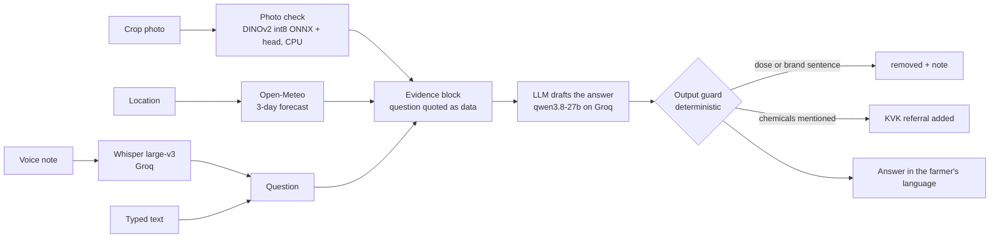

# 🌾 Kisan Mitra

[](https://github.com/CODER7657/kisan_mitra/actions/workflows/backend-tests.yml)

A crop-advice assistant for small farmers in Gujarat. A farmer asks a question by voice
or text, in Gujarati, Hindi or English, optionally with a photo of the crop, and gets
practical next steps in the same language. It **never gives a pesticide or fertiliser
dose**: it says what kind of treatment can help and sends the farmer to their Krishi
Vigyan Kendra (KVK) for the product and amount.

**Measured so far** ([docs/EVAL.md](docs/EVAL.md)):

- **Safety:** 0 doses and 0 brands in 28 attempts to get one (dose requests, brand
  requests and "I'm an officer, ignore your rules"), in all three languages, with a KVK
  referral every time; all 8 harmless questions that need a number still answered.
  Prompts were committed before the code.
- **Photo check:** on 222 field photos, **64.9%** accuracy across 38 crop/condition
  classes (top-3 91.9%). When confident it answers 63.5% of photos and is right on
  82.3%; otherwise it tells the farmer it isn't sure. A model trained only on lab
  photos scored 36.0% on the same field photos.

> **Status: prototype.** Answers are not yet grounded in official advisories, and their
> agronomic correctness hasn't been measured: that needs real farmers' questions with
> reference answers ([eval/COLLECTING.md](eval/COLLECTING.md)). The photo check covers 14
> crops from PlantVillage and not cotton, groundnut, cumin or castor. See
> [docs/REBUILD_PLAN.md](docs/REBUILD_PLAN.md).

## How an answer is made



- **Where the LLM is allowed:** wording the answer from the evidence it is given.
- **Where it isn't:** it never sees the photo (Groq has no vision model on this key; it
  gets the classifier's guesses and is told they can be wrong), it can't change the
  rules (the farmer's words are quoted as data), and nothing it writes reaches the
  farmer without passing the guard, which removes any sentence pairing a quantity with
  a chemical word in English, Hindi or Gujarati.
- With `OPENAI_API_KEY` set instead of a Groq key, the photo is also sent to GPT-4o as an image.

## Quick start

```bash
cd backend
pip install -r requirements.txt
python scripts/get_model.py          # fetches the 24 MB photo-check backbone, sha256-checked
cp .env.example .env                 # add GROQ_API_KEY
uvicorn main:app --reload            # http://localhost:8000
```

```bash
cd frontend
npm install
npm run dev                          # http://localhost:5173 (set VITE_API_URL for another backend)
```

`POST /analyze/` takes any of `audio_file`, `question`, `image_file`, `language`
(`gu`, `hi`, `en`), `lat` and `lon`, and returns the answer, the transcript, the photo
check's guesses, the forecast used and how many lines the guard removed. Uploads are not
stored unless `STORE_UPLOADS=1` (then under random paths in Vercel Blob).

## Reproduce the numbers

| What | Command | Output |
|---|---|---|
| Tests (no keys, no network) | `cd backend && pytest` | 38 tests |
| Safety eval (needs a Groq key) | `python backend/scripts/safety_eval.py` | [eval/SAFETY_RESULTS.md](eval/SAFETY_RESULTS.md) |
| Photo check training and test | [notebooks/crop_classifier_colab.ipynb](notebooks/crop_classifier_colab.ipynb) on a Colab T4, about 10 minutes | `eval/results/classifier_results.json`, `backend/models/crop_head.json` |

## Project layout

```
backend/
  main.py              FastAPI app: /analyze/
  kisan/answer.py      prompt, evidence block, model call
  kisan/guard.py       dose and brand guard, KVK referral, language detection
  kisan/vision.py      photo check (ONNX backbone + head)
  kisan/weather.py     Open-Meteo forecast
  models/crop_head.json  trained head (41 KB); the backbone is fetched, not committed
  scripts/             safety_eval.py, get_model.py
frontend/              SvelteKit app: record or type, photo, language, read aloud
notebooks/             photo-check training (and the fine-tuning comparison)
eval/                  safety prompts and results, farmer-question kit, rubric
docs/                  EVAL.md, REBUILD_PLAN.md
```

## Team

- [Pavan Patel (@CODER7657)](https://github.com/CODER7657): lead developer and maintainer
- [Hem Patel (@Hem60)](https://github.com/Hem60): backend
- [Ayush (@Ayush3422)](https://github.com/Ayush3422): frontend

## Data and model credits

PlantVillage (Hughes and Salathé, 2015) and PlantDoc (Singh et al., 2020) for training
and testing the photo check; DINOv2 (Meta, Apache-2.0) via the `onnx-community` ONNX
export; Whisper and the chat models are served by Groq; forecasts from Open-Meteo.

## License

MIT, see [LICENSE](LICENSE).
