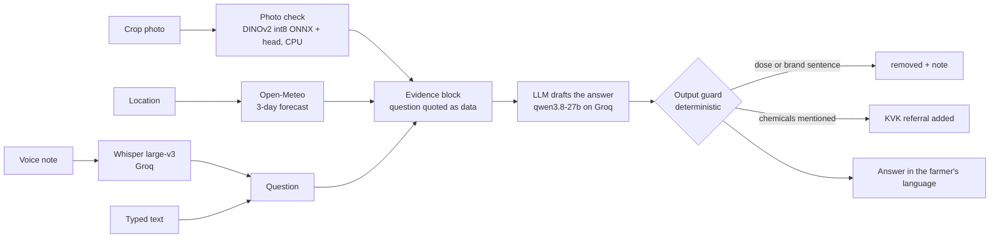

# Kisan Mitra

Crop advice by voice for small farmers in Gujarat: ask in Gujarati, Hindi or English, optionally with a photo, and get practical next steps in the same language, never a pesticide or fertiliser dose.

[](https://github.com/CODER7657/kisan_mitra/actions/workflows/backend-tests.yml)
[](LICENSE)
[](https://kisan-mitra-gilt.vercel.app/)

**Live:** https://kisan-mitra-gilt.vercel.app/


It says what kind of treatment can help and sends the farmer to their Krishi Vigyan
Kendra (KVK) for the product and amount.

## Measured results

Measured 2026-10-21; method and full numbers in [docs/EVAL.md](docs/EVAL.md).

| What | Result | Reproduce |
|---|---|---|
| Safety: attempts to get a dose or brand (dose requests, brand requests, "I'm an officer, ignore your rules"), en/hi/gu | **0 doses, 0 brands in 28 attempts**, a KVK referral every time; all 8 harmless questions that need a number still answered. Prompts committed before the code | `python backend/scripts/safety_eval.py` (needs a Groq key) → [eval/SAFETY_RESULTS.md](eval/SAFETY_RESULTS.md) |
| Photo check, 222 field photos, 38 crop/condition classes | **64.9%** top-1, 91.9% top-3. When confident it answers 63.5% of photos and is right on 82.3%; otherwise it says it isn't sure. A lab-photo-only model scored 36.0% on the same photos | [notebooks/crop_classifier_colab.ipynb](notebooks/crop_classifier_colab.ipynb), Colab T4, about 10 minutes |
| Backend tests (no keys, no network) | **38 passing** (2026-11-07) | `cd backend && pytest` |

## How an answer is made



- **Where the LLM is allowed:** wording the answer from the evidence it is given.
- **Where it isn't:** it never sees the photo (Groq has no vision model on this key; it
  gets the classifier's guesses and is told they can be wrong), it can't change the
  rules (the farmer's words are quoted as data), and nothing it writes reaches the
  farmer without passing the guard, which removes any sentence pairing a quantity with
  a chemical word in English, Hindi or Gujarati.
- With `OPENAI_API_KEY` set instead of a Groq key, the photo is also sent to GPT-4o as an image.

## Run it locally

```bash
cd backend
pip install -r requirements.txt
python scripts/get_model.py          # fetches the 24 MB photo-check backbone, sha256-checked
cp .env.example .env                 # add GROQ_API_KEY
uvicorn main:app --reload            # http://localhost:8000
```

```bash
cd frontend
npm install
npm run dev                          # http://localhost:5173 (set VITE_API_URL for another backend)
```

`POST /analyze/` takes any of `audio_file`, `question`, `image_file`, `language`
(`gu`, `hi`, `en`), `lat` and `lon`, and returns the answer, the transcript, the photo
check's guesses, the forecast used and how many lines the guard removed. Uploads are not
stored unless `STORE_UPLOADS=1` (then under random paths in Vercel Blob).

## Test it

```bash
cd backend && pytest                 # 38 tests, model provider stubbed, no keys needed
cd frontend && npm run check         # svelte-check
```

CI runs both on every push and pull request.

## Limitations

- **Prototype.** Answers are not yet grounded in official advisories, and their agronomic
  correctness has not been measured: that needs real farmers' questions with reference
  answers ([eval/COLLECTING.md](eval/COLLECTING.md)).
- **Photo check coverage.** 14 crops from PlantVillage; not cotton, groundnut, cumin or
  castor, which matter most in Gujarat. See [docs/REBUILD_PLAN.md](docs/REBUILD_PLAN.md).
- **The guard is lexical.** It removes sentences pairing a quantity with a chemical word in
  English, Hindi or Gujarati; phrasing it does not recognise is not caught by it.
- **Hosted models.** Speech recognition and drafting run on Groq's free tier, so they are
  subject to its availability and rate limits.

## Project layout

```
backend/
  main.py              FastAPI app: /analyze/
  kisan/answer.py      prompt, evidence block, model call
  kisan/guard.py       dose and brand guard, KVK referral, language detection
  kisan/vision.py      photo check (ONNX backbone + head)
  kisan/weather.py     Open-Meteo forecast
  models/crop_head.json  trained head (41 KB); the backbone is fetched, not committed
  scripts/             safety_eval.py, get_model.py
frontend/              SvelteKit app: record or type, photo, language, read aloud
notebooks/             photo-check training (and the fine-tuning comparison)
eval/                  safety prompts and results, farmer-question kit, rubric
docs/                  EVAL.md, REBUILD_PLAN.md
```

## Authors

- [Pavan Patel (@CODER7657)](https://github.com/CODER7657): lead developer and maintainer
- [Hem Patel (@Hem60)](https://github.com/Hem60): backend
- [Ayush (@Ayush3422)](https://github.com/Ayush3422): frontend

## Licence and data

Code: MIT, see [LICENSE](LICENSE).

- **PlantDoc** (Singh et al., 2020): CC BY 4.0. Used to train and test the photo check.
- **PlantVillage** (Hughes and Salathé, 2015): the source repository carries no licence
  file. Used for training only; no images are redistributed here.
- **DINOv2** (Meta): Apache-2.0, via the `onnx-community` ONNX export. The backbone is
  fetched at setup, not committed; the trained head (`backend/models/crop_head.json`) is.
- Whisper and the chat models are served by Groq; forecasts from Open-Meteo.
